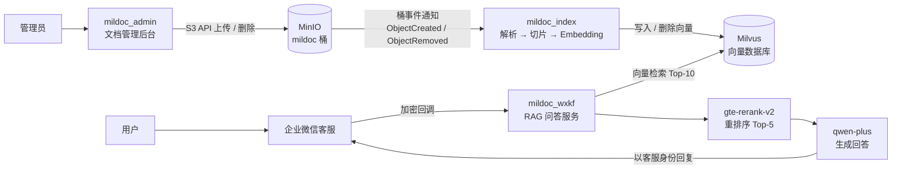

# Mildoc 企业知识库：基于 Milvus + MinIO 的事件驱动 RAG 系统
 
## 项目概述
 
Mildoc 是一个企业知识库与智能问答项目。管理员上传文档后，系统通过**对象存储事件驱动**自动完成文档解析、切片、向量化并写入向量数据库；文档删除时同步清理向量，保证存储与索引数据一致。员工提问时，系统通过**向量检索 → Rerank 重排 → 大模型生成**，给出基于企业文档的回答，并接入企业微信客服作为问答入口。
 
整个系统部署在阿里云 ECS 上，向量数据库使用 Docker Compose 部署 Milvus Standalone，三个业务服务分别负责文档索引、文档管理和智能问答。
 
## 技术栈
 
| 环节 | 工具 |
|---|---|
| 对象存储 | MinIO（S3 协议，兼容阿里云 OSS） |
| 向量数据库 | Milvus 2.6 Standalone（etcd + MinIO），Attu 可视化管理 |
| 向量索引 | `IVF_FLAT` + `COSINE`，`nlist=1024`，检索 `nprobe=64` |
| Embedding | `text-embedding-v4`（768 维） |
| 重排序 | `gte-rerank-v2` |
| 大语言模型 | `qwen-plus`（OpenAI 兼容接口） |
| 服务框架 | Python 3.12、Flask、LangChain、pymilvus、minio-py |
| 消息入口 | 企业微信自建应用 + 微信客服 API |
| 部署 | 阿里云 ECS、Docker / Docker Compose、uv |
 
## 系统架构
 

 
## 目录结构
 
```
mildoc/
├── mildoc_milvus/
│   ├── milvus_local/        # Milvus + etcd + MinIO 单机部署（Docker Compose）
│   ├── milvus_minio/        # 对接独立 MinIO 集群的部署方式
│   ├── milvus_oss/          # 对接阿里云 OSS 的部署方式
│   └── run_attu             # 启动 Attu 管理界面
├── mildoc_index/            # 文档索引服务
│   ├── main.py              # 入口，支持 listen / backfill / full-refresh 三种模式
│   ├── minio_event_handler.py   # MinIO 桶事件监听
│   ├── oss_event_handler.py     # 阿里云 OSS + MNS 消息队列事件处理
│   ├── parser/              # PDF / Office / Markdown / Text 解析器
│   ├── embedding.py         # 文本向量化
│   └── milvus_api.py        # 集合与索引创建、向量写入与删除
├── mildoc_admin/            # 文档管理后台（Flask）
│   ├── admin_app.py
│   ├── static/
│   └── templates/
├── mildoc_wxkf/             # 智能问答服务
│   ├── wxkf_callback_app.py # 企业微信回调入口（签名校验、消息解密）
│   ├── kf_message_handler.py    # 客服消息拉取、去重与分发
│   ├── rag_service.py       # 检索与生成
│   ├── rerank_service.py    # 重排序
│   ├── wecom_api.py         # 企业微信接口封装
│   └── cursor_manager.py    # 消息拉取游标与已处理消息持久化
├── pyproject.toml
└── uv.lock
```
 
## 核心功能
 
### 1. 事件驱动的文档入库
 
1. 文档上传到 MinIO `mildoc` 桶，MinIO 推送 `s3:ObjectCreated` 事件
2. `mildoc_index` 收到事件后下载文档，按文件类型选择解析器并切片
3. 调用 Embedding 生成向量，**先删除同名文档的旧记录再插入**，保证重复上传的幂等性
4. 文档删除时收到 `s3:ObjectRemoved` 事件，按文档路径清理 Milvus 中的向量
索引服务提供三种运行模式：
 
- `listen`：实时监听桶事件
- `backfill`：扫描桶内文件，补建服务停机期间遗漏的索引
- `full-refresh`：全量重建，用于更换 Embedding 模型或调整切片策略后
同一套业务逻辑适配两种事件来源：本地 MinIO 通过长连接监听，阿里云 OSS 通过 MNS 消息队列转发，用 `--provider` 参数切换。
 
### 2. 文档管理后台
 
- 目录创建，文档上传与删除
- 查看文档 MD5、大小、索引状态、嵌入模型
- 查看文档的全部切片内容
业务人员通过后台操作文档，不直接接触 MinIO 与 Milvus 的管理账号，实现权限隔离。
 
### 3. RAG 智能问答
 
1. 企业微信推送加密回调通知，服务完成**签名校验与 AES 解密**后立即返回，在后台线程中处理，避免回调超时
2. 使用回调中的 Token 与持久化的 cursor 拉取新消息，按 `msgid` 去重，只处理 10 分钟内的用户消息
3. 查询会话状态，人工接待中的会话不由机器人回复；用户发送「转人工」时将会话转入接待池
4. 问题向量化后在 Milvus 中检索 Top-10，经 Rerank 取 Top-5，并保留向量检索的最高分片段作为保底
5. 将片段作为上下文交给 `qwen-plus` 生成回答，以客服账号身份回复用户
## 运行效果
 
| 指标 | 结果 |
|---|---|
| 示例文档 | 24,109 字符的员工手册 PDF，切分为 14 个片段 |
| 入库耗时 | 从收到上传事件到 14 个片段全部写入 Milvus 约 **6 秒** |
| 向量查询 | Attu 查询集合数据约 **41 ms** |
| 删除同步 | 删除文档后，对应向量由删除事件自动清理 |
| 问答链路 | 回调验证 → 消息拉取 → 检索 → 重排 → 生成 → 回复，全链路跑通 |
 
## 快速开始
 
### 1. 部署 Milvus
 
```bash
mkdir -p /docker_data_volume/milvus_local
cd mildoc_milvus/milvus_local
echo "DOCKER_VOLUME_DIRECTORY=/docker_data_volume/milvus_local" > .env
docker compose up -d
```
 
启动后在 MinIO 控制台（端口 9001）创建 `mildoc` 桶，在 Attu 中创建 `mildoc` 数据库。
 
### 2. 配置环境变量
 
每个服务目录下提供了 `.env.example`，复制为 `.env` 后填入自己的配置：
 
```bash
cp mildoc_index/.env.example mildoc_index/.env
cp mildoc_admin/.env.example mildoc_admin/.env
cp mildoc_wxkf/.env.example mildoc_wxkf/.env
```
 
### 3. 启动服务
 
```bash
uv sync
cd mildoc_index && uv run main.py --provider minio --mode listen   # 文档索引服务
cd mildoc_admin && uv run admin_app.py                             # 管理后台，端口 8870
cd mildoc_wxkf  && uv run wxkf_callback_app.py                     # 问答服务，端口 8890
```
 
## 项目中遇到的问题与解决
 
### 1. MinIO 官方镜像下架
 
部署 Milvus 时，`minio/minio` 镜像在加速站、quay.io 和海外直连 Docker Hub 均无法拉取，分别报 `manifest not found`、`unauthorized` 和 `repository does not exist`。我逐一排除网络因素后，确认是上游已从 Docker Hub 删除镜像、quay.io 也不再允许匿名拉取。最终通过离线镜像包 `docker save` / `docker load` 完成部署。
 
### 2. 无扩展名文件被静默跳过
 
测试时上传了一个没有扩展名的文本文件，Content-Type 为 `application/octet-stream`，解析器选择逻辑只依据扩展名和 Content-Type，于是落到空解析器，文件被跳过且没有任何提示，后台只显示「未索引」。改进方向：上传时做文件类型的前置校验，或通过文件魔数识别真实类型，并在后台展示失败原因。
 
### 3. 删除向量时主键类型错误
 
删除文档时，管理后台按 `id` 删除 Milvus 记录报错：Int64 主键被以字符串形式传入。由于索引服务也会处理删除事件，向量最终被正确清理，问题被掩盖。我从日志中发现了这个被吞掉的异常，原因是大整数 id 在前后端传递时被转成字符串后没有转回。改进方向：修正类型转换，并让删除向量只由索引服务负责，避免两条路径逻辑不一致。
 
### 4. 网络与安全配置
 
服务器只对公网开放企业微信回调端口，MinIO、Milvus、管理后台等端口均通过 SSH 端口转发访问；Attu 运行在独立容器中，需通过宿主机私网 IP 访问 Milvus。密钥统一放在 `.env` 中且不纳入版本控制，仓库只提供清空敏感值的 `.env.example`。